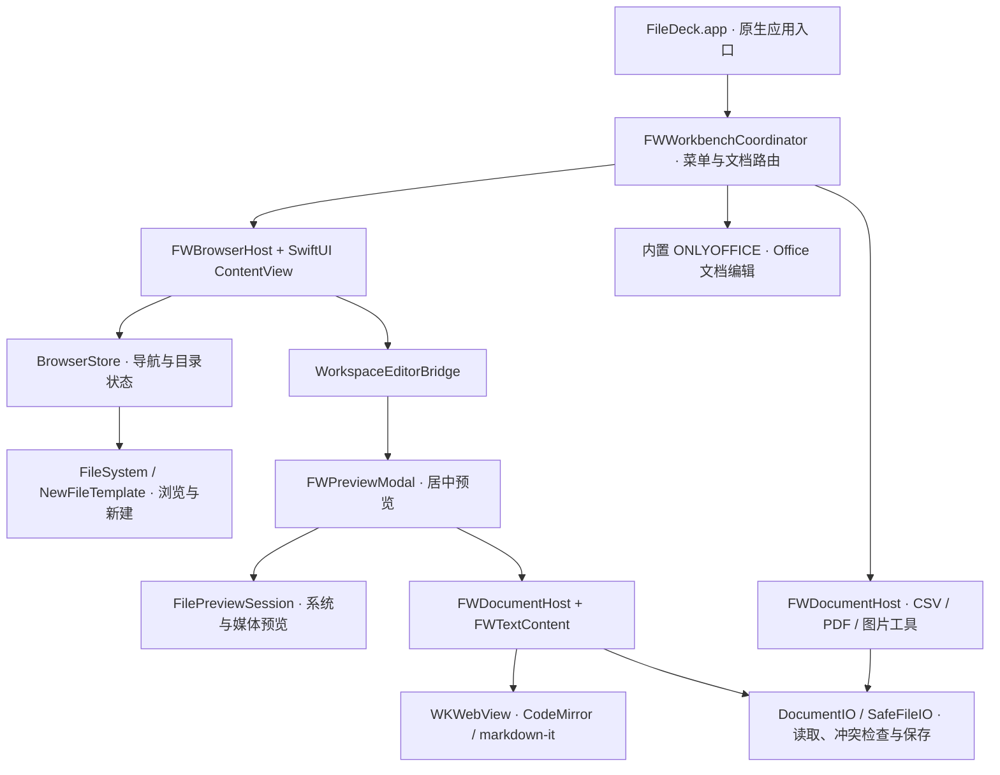

# FileDeck

FileDeck 是面向 **macOS 14+、Apple Silicon（ARM64）** 的本地文件工作台。它把目录管理、文件预览和常见文档编辑放在同一个窗口中，适合浏览项目资料、阅读 Markdown，以及处理 Office、CSV、PDF 和图片。

完整应用内置 ONLYOFFICE 编辑内核、CodeMirror 和 Markdown 渲染资源，日常使用无需另装 Microsoft Office、Markdown 插件、Node.js 或 Python。源码构建所需的工具与运行要求分别说明在下文。

[下载安装](#下载与安装) · [功能介绍](#功能介绍) · [使用方法](#使用方法) · [源码结构图](#源码结构图) · [构建与运行](#构建与运行) · [测试与验证](#测试与验证) · [常见问题](#常见问题)

## 下载与安装

完整应用从 [GitHub Releases · v0.1.0](https://github.com/liuweqwojeo/FileDeck/releases/tag/v0.1.0) 下载：

- [FileDeck 0.1.0 · macOS ARM64 下载包](https://github.com/liuweqwojeo/FileDeck/releases/download/v0.1.0/FileDeck-v0.1.0-macOS-arm64.zip)
- [SHA-256 校验文件](https://github.com/liuweqwojeo/FileDeck/releases/download/v0.1.0/SHA256SUMS.txt)

当前 ZIP 安装包约 **792 MB（755.24 MiB）**，解压后的 `FileDeck.app` 文件总量约 **1.366 GB**；两者分别表示下载体积和应用文件总量，实际磁盘占用会因文件系统而异。

支持 macOS 14+、Apple Silicon。用 macOS 内置归档工具解压，将其中的 `FileDeck.app` 拖入“应用程序”后打开；同包附有安装说明、第三方许可证及源码获取入口。

当前为开发预览版，使用临时签名，尚未完成 Developer ID 签名与 Apple 公证。如果系统阻止打开，请先确认下载来源和校验值，再参考 [Apple 官方打开说明](https://support.apple.com/zh-cn/102445)。

此包保留现有编辑器、语言、拼写字典、文档模板和插件。打包时对完全相同的静态资源使用包内相对链接去重，并无损压缩离线帮助和拼写字典，按需读取且不创建完整解压缓存。相较上一轮静态去重后的应用，解压后的文件总量再减少约 **250.1 MB（15.47%）**，保留离线使用能力。当前安装包更新见 [GitHub Release](https://github.com/liuweqwojeo/FileDeck/releases/tag/v0.1.0)，实现与验收见 [离线资源压缩说明](docs/onlyoffice-build.md#离线帮助与拼写字典压缩)；原版验证和回退方法见 [0.1.0 发布说明](docs/releases/v0.1.0.md)。

## 功能介绍

| 功能 | 可以做什么 |
| --- | --- |
| 多目录管理 | 添加多个本地管理目录，快速访问桌面、下载和文稿；保留目录展开状态、浏览位置和分栏宽度。 |
| 文件浏览 | 列表/网格切换、多选、当前目录名称搜索、类型筛选、排序，以及显示或隐藏隐藏文件。 |
| 同窗预览 | 双击文件、按 Space/Return 或右键“预览”，在当前窗口的居中弹窗中查看内容，关闭后回到原文件列表。 |
| 文本与代码 | 编辑纯文本、Markdown、JSON、YAML 和常见代码；支持语法高亮、查找替换、撤销重做及 JSON 格式化。 |
| Office 文档 | 完整应用通过内置 ONLYOFFICE 内核新建、打开、编辑和保存 DOCX、XLSX、PPTX。 |
| CSV 表格 | 编辑单元格、添加/删除行列，选择逗号、分号或 Tab 分隔符及文本编码。 |
| PDF 工具 | 阅读、旋转页面、文字高亮、文字批注、合并 PDF、提取页面和追加图片页。 |
| 图片工具 | PNG/JPEG/HEIC 读取，旋转、按像素裁剪和调整尺寸；保存或导出 PNG/JPEG。 |
| 右键新建 | 从目录树、文件列表或空白区域创建文件夹、办公文档、文本、代码、配置和图片。 |
| 文件操作 | 拖动移动、Option 拖动复制、外部拖入复制、拖出到 Finder；支持重命名、复制路径和移到废纸篓，同名冲突时拒绝覆盖。 |
| 保存保护 | 关闭、切换文件和退出时检查未保存内容；文本、CSV、PDF、图片保存前检查外部修改，避免静默覆盖。 |

### 支持的文件与打开方式

“只读预览”和“进入编辑器”是两个入口。双击文件先预览；文本类文件可在预览弹窗中点击“编辑”。Office、CSV、PDF、图片的完整编辑功能通过顶部 **“打开文件”** 或系统 **“文件”菜单** 进入。

| 文件类型 | 预览与编辑能力 | 需要注意 |
| --- | --- | --- |
| Markdown：`.md`、`.markdown` | 内置阅读视图、源码编辑与预览 | 无需安装插件；远程图片、相对路径图片与链接受资源访问限制。 |
| 文本、代码、JSON、YAML | 内置文本预览与 CodeMirror 编辑 | 完整文本编辑上限为 10 MiB；无法安全解码时不允许直接编辑保存。 |
| Office：`.docx`、`.xlsx`、`.pptx` | 内置 ONLYOFFICE 编辑；浏览预览走系统服务 | 完整编辑无需外部办公软件；只读预览效果取决于 macOS 的 Quick Look。 |
| CSV：`.csv` | 原生表格编辑，也可从浏览列表预览 | TSV 可新建并作为文本打开；CSV 编辑器可选择 Tab 分隔符。 |
| PDF：`.pdf` | 系统预览和内置 PDFKit 编辑工具 | 页面与批注操作不是任意正文排版编辑。 |
| 图片：`.png`、`.jpg`、`.jpeg`、`.heic` | 图片预览及基础编辑 | HEIC 修改后需另存为 PNG/JPEG。 |
| 音视频 | 使用系统 AVPlayerView 播放 | 支持范围取决于系统解码能力；不自动播放，关闭预览会停止并释放资源。 |
| RTF、SVG、旧 Office 及其他格式 | 尝试系统 Quick Look | 能新建不代表已有专用编辑器；不支持的格式提供文件属性和默认应用打开入口。 |

## 使用方法

### 启动与添加目录

1. 打开完整应用 `FileDeck.app`。普通启动先进入欢迎页。
2. 选择本地文件夹加入管理目录；有历史记录时，可点击“继续上次工作区”。也可先跳过添加目录进入工作台。
3. 点击左侧目录名称进入目录，点击箭头展开或收起子目录；名称右侧的行内空白也可点击。
4. 单击文件只选中，双击目录进入目录；双击文件或按 Space/Return 打开预览。
5. 关闭预览后，保留原目录、选择、筛选、排序、目录展开和列表滚动位置。

从管理列表移除目录只会取消引用，不会删除磁盘文件。显式命令行 `--open` 或外部打开文件会直接处理指定路径。

可从左侧目录树、快速访问或文件列表/网格拖动文件夹与文件，放到目标目录行或当前目录空白处。应用内默认移动，按住 Option 拖放则复制；列表与网格支持将选中的多个项目一起移动或复制。从 Finder 拖入始终复制，也可以将单个项目拖出到 Finder。目标目录会高亮，同名项目、拖到自身或子目录的操作会被拒绝。

单击文件后，选中行显示蓝色背景与勾选标记，下方显示选中文件名。使用 **复制 / 粘贴** 按钮、右键菜单或 **⌘C / ⌘V** 复制文件，也可与 Finder 互相复制粘贴；粘贴同名文件或在原目录粘贴时自动生成“副本”名称，原文件保留。搜索框和文档编辑器中的文本复制粘贴仍按原方式工作。

### 顶部按钮说明

| 按钮 | 用途 |
| --- | --- |
| 后退 / 前进 | 在本次浏览的目录历史之间切换。 |
| 上级 | 进入当前目录的父目录。 |
| 刷新 | 重新读取当前目录。 |
| 添加目录 | 把本地文件夹加入左侧管理列表。 |
| 打开文件 | 在完整应用中进入对应文档编辑器。 |
| 新建 | 在当前目录选择模板并命名创建文件或文件夹。 |
| 复制路径 | 复制所选文件的路径；窗口较窄时可通过右键菜单使用。 |
| 隐藏文件 | 切换显示以点开头的文件。 |
| 搜索框 / 列表与网格 | 按名称过滤当前目录，或切换文件展示方式；搜索不递归扫描子目录。 |

### 右键新建

在左侧目标目录、文件列表项目或列表空白处右键，选择“新建 → 文件类型”，填写名称后创建。在目录上右键以该目录为目标，在文件上右键以其所在目录为目标；顶部“新建”使用当前目录。

| 分类 | 内置类型 |
| --- | --- |
| 文件夹 | 文件夹 |
| 办公文档 | Word（DOCX）、Excel（XLSX）、演示文稿（PPTX）、PDF、CSV、TSV、RTF |
| 文本与代码 | TXT、Markdown、JSON、YAML、XML、HTML、CSS、JavaScript、TypeScript、Python、Swift、Java、SQL、Shell、TOML、INI |
| 图片 | PNG、JPEG、SVG |
| 其他 | 自定义扩展名的空白文本文件 |

Office 使用应用内的真实空白模板，PDF 和 PNG/JPEG 生成可解码的有效文件。自定义扩展名匹配已知模板时仍使用对应模板；未支持的二进制格式会提示错误，不能通过改扩展名生成有效的压缩包、音视频或其他二进制文档。

创建时检查目标目录是否变化，拒绝同名覆盖；失败后保留填写的名称，成功后显示并选中新文件。

### 编辑与保存

文本预览中点击“编辑”开始修改，使用保存按钮或 `⌘S` 写入文件。Office、CSV、PDF 和图片请从“打开文件”进入相应工具。

有未保存内容时，关闭弹窗、按 Esc/`⌘W`、切换文件、关闭窗口或退出应用都会进入保存确认。取消关闭会保留当前草稿与编辑器状态。文本、CSV、PDF 和图片在外部被修改时会阻止静默覆盖；文件已被删除时保留草稿，通过系统“另存为”选择新目标。Office 的保存与未保存状态由内置 ONLYOFFICE 内核处理。

## 源码结构图

[查看交互式架构图](docs/filedeck-architecture.html)：覆盖浏览预览、原生编辑、ONLYOFFICE 和当前工作树中的架构变化，支持节点探索、主题切换及图片导出。下载或克隆仓库后，用浏览器打开该 HTML 文件即可查看。

### 仓库目录

```text
FileDeck/
├── Sources/FileWorkbench/          # SwiftUI 浏览界面和文件处理基础模块
│   ├── ContentView.swift           # 工具栏、目录树、文件列表和右键菜单
│   ├── BrowserStore.swift          # 目录加载、导航历史、工作区恢复和目录树缓存
│   ├── WorkspaceStartupView.swift  # 欢迎页与继续上次工作区
│   ├── WorkspaceEditorBridge.swift # 浏览界面与原生编辑宿主的桥接
│   ├── NewFileTemplate.swift       # 新建类型、有效模板和排他创建
│   ├── FileCapabilities.swift      # 文件类型识别与可用编辑后端
│   ├── FileSystem.swift            # 文件元数据、排序、包和符号链接边界
│   ├── FilePreviewView.swift       # 文本、Quick Look 和媒体预览会话
│   ├── DocumentIO.swift            # 文本编码、读取和保存
│   ├── SafeFileIO.swift            # 文件快照、冲突检测与安全写入
│   ├── CSVDocument.swift           # CSV 解析和行列模型
│   └── MediaOperations.swift       # PDF 与图片处理
├── NativeOffice/
│   ├── Workbench/                  # AppKit / Objective-C++ 原生集成层
│   │   ├── FWWorkbenchCoordinator.mm # 菜单路由、文档会话和 Office 退出链
│   │   ├── FWBrowserHost.swift     # 持续保留浏览界面的原生宿主
│   │   ├── FWPreviewModal.swift    # 居中预览、焦点与关闭保护
│   │   ├── FWDocumentHost.swift    # 本地文档打开、保存和生命周期
│   │   ├── FWTextContent.swift     # WKWebView / CodeMirror 文本编辑
│   │   ├── FWCSVContent.swift      # CSV 表格界面
│   │   ├── FWPDFContent.swift      # PDFKit 工具界面
│   │   └── FWImageContent.swift    # 图片工具界面
│   ├── Smoke/                     # ONLYOFFICE 实际编辑验收钩子
│   └── Tests/                     # 原生媒体内容回归辅助代码
├── EditorAssets/                  # CodeMirror / markdown-it 源码与依赖锁
│   ├── src/                       # 编辑器、Markdown、JSON 和换行处理
│   ├── tests/                     # JavaScript 测试
│   └── build.mjs                  # 离线编辑资源打包
├── Resources/
│   ├── Editors/                   # 已打包编辑资源及第三方声明
│   ├── FileDeck.icns              # macOS 应用图标
│   └── Info.plist                 # 独立浏览验证应用配置
├── Tests/
│   ├── FileWorkbenchTests/        # Swift 文件处理和浏览状态测试
│   └── BuildToolsTests/           # Python 构建、补丁和打包检查
├── scripts/
│   ├── build-app.sh               # 完整应用或浏览验证应用构建入口
│   ├── onlyoffice/                # 固定版本、源码获取、内核构建、补丁与打包
│   └── test-*.sh                  # WebKit、原生宿主和新建格式验收入口
├── docs/                          # 架构、构建与交互验收说明
├── Package.swift                  # Swift Package，供基础模块测试和浏览 UI 开发
└── LICENSE
```

图中列出主要模块。`vendor/onlyoffice/` 由脚本获取上游源码，`build/` 和 `.build/` 保存本机构建产物；三者均不提交到仓库。

### 模块关系



浏览界面持续挂载，预览与编辑作为同窗工作层呈现。文本编辑资源通过 WKWebView 加载本地文件；Office 编辑由打包的原生内核处理。集成细节见 [原生集成说明](docs/native-integration.md)。

## 构建与运行

仓库保存源码，**不包含**完整的 `FileDeck.app`、ONLYOFFICE 上游源码和内核产物。已经拿到完整应用的用户可直接打开 `.app`；从本仓库开始的开发者请按以下步骤构建。

### 环境要求

| 场景 | 要求 |
| --- | --- |
| 运行完整应用 | macOS 14 或更新版本，Apple Silicon；不需要 Node/Python 或外部办公软件。 |
| 开发浏览 UI | 上述系统与架构、Xcode / Swift 工具链。 |
| 构建完整应用 | 完整 Xcode、Python 3.9+、Node/npm、Qt 5 qmake、CMake、Make、Perl、curl、Git；部分上游工具需要 Rosetta。 |
| 重建本地文本编辑资源 | Node.js 22.12+，使用仓库锁定的 npm 依赖。 |

完整首次构建建议至少预留 100 GiB 空闲空间。首次获取源码和依赖需要联网；运行打包后的本地编辑器不依赖在线服务。固定工具版本和准备步骤见 [ONLYOFFICE 构建说明](docs/onlyoffice-build.md)。

### 获取源码

```bash
git clone https://github.com/liuweqwojeo/FileDeck.git
cd FileDeck
```

后续命令均在项目根目录执行。文档使用相对路径，不依赖开发者机器的目录结构。

### 方式一：构建完整工作台

先检查环境，并按 [构建说明](docs/onlyoffice-build.md#环境准备) 准备缺失工具，包括 Qt 5 qmake：

```bash
python3 scripts/onlyoffice/doctor.py --environment-only
```

环境准备完成后，获取锁定源码、编译 ARM64 内核，再构建原生应用并打包：

```bash
python3 scripts/onlyoffice/fetch.py
python3 scripts/onlyoffice/build.py --phase core --qt-prefix build/onlyoffice/toolchains/qt@5/5.15.19
bash scripts/build-app.sh
open build/FileDeck.app
```

示例 Qt 路径对应构建说明中的项目内工具链；已有其他 Qt 5 qmake 时，替换 `--qt-prefix` 的参数。`build-app.sh` 默认只构建原生应用层并打包，首次构建前必须先完成内核阶段。单独打开 `Package.swift` 不会生成完整 Office 工作台。

已有匹配的原生构建产物时，可运行 `bash scripts/build-app.sh --package-only` 只打包。该入口不会补齐缺失的内核或应用二进制。完整构建日志位于 `build/onlyoffice/logs/`，旧应用备份位于 `build/previous-apps/`。

### 方式二：仅开发浏览界面

```bash
bash scripts/build-app.sh --browser-only
open build/FileDeck浏览验证.app
```

此入口生成独立的浏览验证应用，供目录树、文件列表和浏览 UI 开发使用，不包含完整 Office 内核与原生文档编辑会话。它不会覆盖完整的 `build/FileDeck.app`。

### 重建文本编辑资源

`Resources/Editors/` 已包含打包资源。修改 `EditorAssets/src/` 后再执行：

```bash
npm --prefix EditorAssets ci --ignore-scripts --no-audit --no-fund
npm --prefix EditorAssets run build
```

然后重新构建完整应用，将资源装入应用包。资源协议与安全限制见 [编辑资源说明](EditorAssets/README.md)。

若要临时打开一个测试目录，可显式指定路径：

```bash
open build/FileDeck.app --args --open /path/to/sample-folder
```

### 签名与分发状态

当前本地构建使用临时签名，未启用 App Sandbox，未完成正式分发签名与公证。正式对外分发前需单独完成这些工作；不要把本机构建成功视为已在其他机器验收。打开受保护目录时，仍可能需要 macOS 的目录访问授权。

## 测试与验证

以下命令在 macOS 项目根目录运行。单元测试使用临时目录；原生验收脚本会启动辅助应用，不能把辅助应用作为日常产品入口。

```bash
# Swift：目录状态、文件 I/O、新建模板、CSV、PDF 与图片基础模块
CLANG_MODULE_CACHE_PATH="$PWD/.build/ModuleCache" \
SWIFTPM_MODULECACHE_OVERRIDE="$PWD/.build/ModuleCache" \
swift test --disable-sandbox --cache-path "$PWD/.build/cache"

# Python：构建脚本、依赖检查、补丁与应用包校验
python3 -B -m unittest discover -s Tests/BuildToolsTests -v

# JavaScript：先安装锁定依赖，再验证本地编辑资源
npm --prefix EditorAssets ci --ignore-scripts --no-audit --no-fund
npm --prefix EditorAssets test
```

需要验证真实 macOS 界面时，再选择相应入口：

| 命令 | 检查内容 |
| --- | --- |
| `bash scripts/test-editors.sh` | 实际 WKWebView、编辑桥接、Markdown 资源限制和内容保真。 |
| `bash scripts/test-native-hosts.sh` | 文件列表双击与键盘、目录树点击、右键新建、预览关闭和状态恢复。 |
| `bash scripts/test-modal-documents.sh` | 未保存保护、真实写盘、外部冲突与删除后另存。 |
| `bash scripts/test-file-creation.sh` | 使用完整应用资源，解码验证 Office、PDF、PNG/JPEG 新建结果。 |
| `python3 scripts/onlyoffice/smoke.py --app build/FileDeck.app --workbench` | 构建完整应用后，检查实际 Office 新建、保存、重开及混合文档会话。 |

HEIC 测试依赖 macOS 图像编码服务，应在允许调用该服务的本机环境运行。单元测试不代表复杂 Office 排版、所有系统预览扩展或另一台机器上的兼容性已通过。

测试报告与截图在执行机器的 `build/` 下生成，不随源码提交。已完成的验收范围、历史结果和未覆盖项目见下方文档。

## 常见问题

**预览 Markdown 需要安装组件吗？** 不需要。完整应用已打包 markdown-it 和 CodeMirror，不需要在线下载插件。

**没安装 Office，文档能打开吗？** 完整应用内置 DOCX/XLSX/PPTX 编辑内核，可以从“打开文件”进入编辑。浏览列表中的只读 Office 预览使用系统 Quick Look，是否成功渲染取决于 macOS 及其预览扩展，不能保证所有文档均可预览。

**PDF 需要额外阅读器吗？** 不需要单独安装 PDF 阅读器，应用使用系统 Quick Look/PDFKit；加密、损坏或特殊文件仍可能无法正常读取。

**为什么不能新建任意二进制格式？** 扩展名不能代替真实文件结构。右键菜单为已支持格式生成有效内容，自定义扩展名主要用于其他文本文件。

**为什么每次启动都显示欢迎页？** 这是当前启动行为。点击“继续上次工作区”即可恢复；通过外部打开文件或 `--open` 参数启动时会直接处理指定目标。

**搜索会扫描整个硬盘吗？** 不会。顶部搜索只过滤当前目录，左侧搜索用于目录导航，不提供全盘索引。

**文件会上传到云端吗？** 本地预览和编辑不需要上传到云服务，文本编辑器也不从 CDN 加载资源。对于 iCloud 或网络盘，macOS 和文件提供方可能按其自身行为获取内容。

## 更多文档

| 文档 | 内容 |
| --- | --- |
| [目录与新建交互验收](docs/interaction-repair-acceptance.md) | 当前欢迎页、目录点击、新建菜单的行为与验证范围。 |
| [居中预览验收](docs/modal-preview-acceptance.md) | 预览、编辑、保存、焦点和资源释放的验收场景。 |
| [原生集成说明](docs/native-integration.md) | SwiftUI 浏览页、原生宿主、弹窗和 Office 会话关系。 |
| [ONLYOFFICE 构建说明](docs/onlyoffice-build.md) | 工具准备、固定源码、内核与应用分阶段构建及问题边界。 |
| [编辑资源说明](EditorAssets/README.md) | CodeMirror、Markdown、WKWebView 桥接协议和本地资源构建。 |
| [实施状态](docs/implementation-status.md) | 阶段交付与历史验证依据，阅读时注意各阶段适用范围。 |
| [图标说明](docs/filedeck-icon.md) | FileDeck 图标资源与生成方式。 |

## 许可证与第三方组件

本仓库许可证见 [LICENSE](LICENSE)。ONLYOFFICE、CEF、CodeMirror、markdown-it 等第三方组件保留各自的许可证与声明；仓库的许可证不能代替这些组件的许可要求。编辑资源的声明见 [THIRD-PARTY-NOTICES](Resources/Editors/THIRD-PARTY-NOTICES.txt)，上游组件版本与来源见 [版本锁文件](scripts/onlyoffice/versions.lock.json)。
